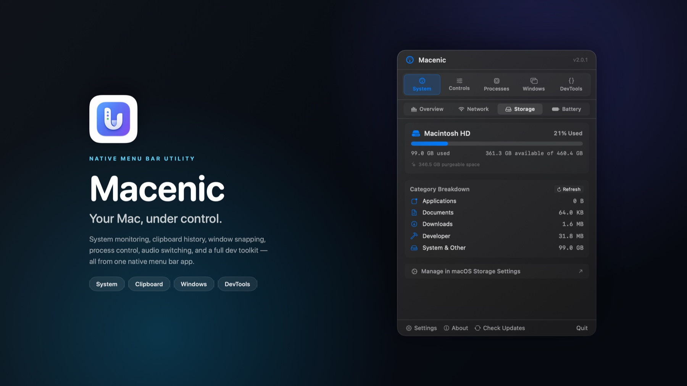
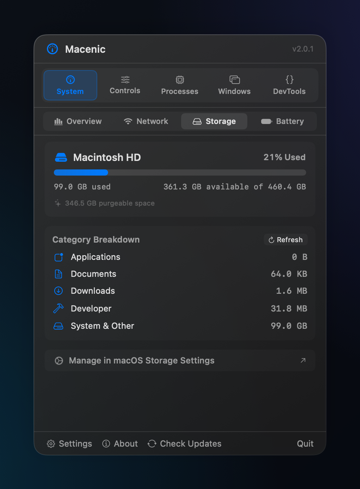
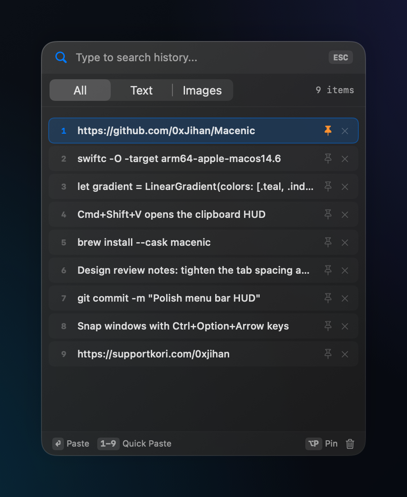

<div align="center">


# Macenic

**Your Mac, under control.**

A native macOS menu bar utility suite for system monitoring, clipboard history, window snapping, process management, audio switching, and everyday developer tools — all in one lightweight app.

<p>
  <a href="https://github.com/0xJihan/Macenic/releases/latest">
    
  </a>
  
  
  
</p>

[**Download for macOS →**](https://github.com/0xJihan/Macenic/releases/latest) · [Features](#features) · [Screenshots](#screenshots) · [Installation](#installation) · [Usage](#usage) · [Build from source](#build-from-source)

</div>

---



<p align="center"><sub><b>Macenic.</b> System health, everyday controls, and developer utilities — one click away in the menu bar.</sub></p>

## Why Macenic?

Most Mac utilities solve one problem and then ask for a subscription. Macenic puts the essentials in one small menu bar app: what your Mac is doing, what you copied, where your windows are, and the developer tools you reach for every day.

- **One app, no Dock clutter.** Macenic lives in the menu bar and stays out of your way.
- **Native from top to bottom.** SwiftUI, AppKit, Mach, IOKit, CoreAudio, and CryptoKit — no Electron, no web views, no third-party SDKs.
- **Fast and light.** Live metrics update without a dashboard window sitting open all day.
- **Private by default.** Clipboard history and settings stay on your Mac. There are no accounts and no telemetry.
- **Keyboard-first.** Open the clipboard HUD, snap a window, or paste an old clip without touching the mouse.

---

## Features

### 📊 Live system dashboard

- **CPU, memory, disk, and GPU gauges** with color-coded thresholds and animated values.
- **Network throughput** for download and upload, plus interface type, local IP, and a one-click latency test.
- **Battery health** with charge level, charging state, time remaining, maximum capacity, condition, cycle count, design capacity, and last-charged time.
- **Storage overview** with used, available, and purgeable space, a category breakdown, and a shortcut to macOS Storage settings.

### 📋 Clipboard manager

- **Persistent history** for text and images. Keeps up to **50 unpinned items** plus anything you pin.
- **Global HUD** at **⌘⇧V**, or open the dedicated clipboard item in the menu bar.
- **Search and filter** by All, Text, or Images.
- **Pin, delete, and clear** entries without leaving the HUD.
- **Hover previews** show long text and full images beside the panel.
- **Keyboard navigation** with arrow keys, **Return** to paste, **1–9** for quick paste, and **⌥P** to pin.
- **Direct auto-paste** into the app you were using before the HUD opened (requires Accessibility permission).

### 🪟 Window manager

- Snap the active window to the **left half**, **right half**, or **top half**.
- **Maximize** a window or **restore** its previous position.
- Customizable global shortcuts, with `Ctrl+Option` + arrow keys by default.
- Requires Accessibility permission.

### ⚙️ Process manager

- **Live process list** with CPU and memory usage.
- **Search** by name or PID, switch between **Apps Only** and **All Processes**, and sort by CPU, memory, name, or PID.
- **Quit** or **force quit** processes, **bring apps to the front**, and **reveal them in Finder**.
- Protected system processes are marked and cannot be terminated from the app.

### 🔊 Audio switcher

- Switch between **audio output and input devices** in two clicks.
- Adjust **input volume** when the selected device supports it.

### 🎛️ Quick toggles

- **Launch at Login** — start Macenic automatically when you log in.
- **Keep Awake** — prevent the display from sleeping.
- **Keyboard Cleaner** — lock keyboard input for 30 seconds. Click anywhere on the overlay to exit early.

### 🧰 Dev toolkit

A full set of utilities inside the dashboard, or in a standalone resizable window:

| Category | What it does |
|---|---|
| **Data** | Format JSON with 2 spaces, 4 spaces, or tabs; minify and validate JSON; Base64 encode/decode (standard and URL-safe); URL encode/decode and query-parameter parsing; JWT decoding with issue and expiry details. |
| **Generators** | UUID v4, UUID v7, and ULID generation; configurable random strings; secure tokens in uppercase hex, Base64, or URL-safe format; live epoch clock and timestamp converter. |
| **Text** | Regex testing and replacement, case conversion, text cleanup transforms, character/word/line/byte counts, and JSON/HTML/URL escaping. |
| **Hashes** | SHA-256, SHA-512, SHA-1, MD5, and HMAC-SHA256 with an optional uppercase output. |

### 🎨 Native by design

- **Glassmorphism** with an adjustable blur/intensity slider.
- **Menu bar first** — Macenic is an `LSUIElement` app, so it never adds a Dock icon.
- **Automatic update checks** against GitHub Releases, with a manual **Check Updates** button in the footer.

---

## Screenshots

<table>
  <tr>
    <td width="50%" valign="top">
      
      <p align="center"><sub><b>System monitoring.</b><br/>Storage capacity, purgeable space, and a category breakdown.</sub></p>
    </td>
    <td width="50%" valign="top">
      
      <p align="center"><sub><b>Clipboard manager.</b><br/>Search history, pin what matters, and paste with Return or 1–9.</sub></p>
    </td>
  </tr>
</table>

---

## Installation

### Requirements

| Requirement | Details |
|---|---|
| **macOS** | macOS 14.6 (Sonoma) or later |
| **Disk space** | About 6 MB |
| **Internet** | Optional — used for update checks and the latency test in the Network tab |
| **Permissions** | Accessibility is optional and only needed for auto-paste, window snapping, and Keyboard Cleaner |

> [!NOTE]
> Macenic is a menu bar app. After launch, look for its icon in the menu bar — there is no Dock icon and no main window. If the icon is hidden, macOS may have moved it into the menu bar overflow area.

### Download & install

1. Open the [**latest release**](https://github.com/0xJihan/Macenic/releases/latest).
2. Download the latest **`.dmg`** file.
3. Open the downloaded `Macenic.dmg`.
4. Drag **Macenic** into your **Applications** folder.
5. Eject the disk image.
6. Open **Applications** and double-click **Macenic**.
7. Click the Macenic icon in the menu bar.

> [!NOTE]
> If the Releases page has no builds yet, use [Build from source](#build-from-source). The source is complete and has no external dependencies.

### First launch: if macOS blocks the app

Macenic is distributed directly through GitHub Releases, outside the Mac App Store. If the build you downloaded is not notarized, Gatekeeper may refuse to open it the first time.

**Only bypass Gatekeeper for a file you downloaded from this repository.** You can always inspect the source or build it yourself.

#### Allow Macenic once

1. Double-click **Macenic** in Applications.
2. If macOS shows *“Apple could not verify ‘Macenic’ is free of malware…”*, click **Done** — do **not** click **Move to Trash**.
3. Open **System Settings** from the Apple menu.
4. Go to **Privacy & Security** and scroll down to **Security**.
5. Find the message that Macenic was blocked and click **Open Anyway**.
6. Authenticate with **Touch ID** or your Mac password.
7. Click **Open** in the confirmation dialog.

Macenic opens, and the menu bar icon appears. **You only need to do this once.**

> [!NOTE]
> On macOS Sequoia and later (including macOS 26 and 27), the old “right-click → Open” trick no longer bypasses Gatekeeper. Use **Privacy & Security → Open Anyway** instead.

### Terminal method (alternative)

If you prefer the terminal, remove the quarantine flag macOS adds to downloaded apps:

```bash
xattr -dr com.apple.quarantine /Applications/Macenic.app
open /Applications/Macenic.app
```

Only do this for an app you obtained from this repository and trust.

### Grant permissions

Some features need extra access. Macenic asks only when you use them.

1. Open **System Settings → Privacy & Security → Accessibility**.
2. Enable **Macenic**.
3. Return to the app and try the feature again.

| Feature | Permission | Why |
|---|---|---|
| Direct auto-paste | Accessibility | Sends the paste keystroke to the previous app |
| Window manager | Accessibility | Moves and resizes windows owned by other apps |
| Keyboard Cleaner | Accessibility | Intercepts keyboard events while active |
| Launch at Login | Login Items | Registers Macenic with macOS |

For **Launch at Login**, approve Macenic under **System Settings → General → Login Items** if macOS asks.

### Troubleshooting

| Problem | Fix |
|---|---|
| No menu bar icon after launch | macOS may have hidden it in the menu bar overflow area. Try widening the menu bar or removing another menu bar item. Confirm Macenic is running in Activity Monitor. |
| *“Apple could not verify Macenic…”* | Follow [Allow Macenic once](#allow-macenic-once). |
| *“Macenic is damaged and can’t be opened.”* | Run `xattr -cr /Applications/Macenic.app`, then open it again. |
| Still “damaged” after that | Re-download the `.dmg` — the download may be incomplete. |
| “You do not have permission to open the application.” | Make sure Macenic is in `/Applications`, not still inside the `.dmg`. Check permissions with **File → Get Info** in Finder. |
| Window snapping does nothing | Grant Accessibility permission and check that the shortcut is not already used by another app. |
| Auto-paste only copies, but does not paste | Grant Accessibility permission. Make sure the app you want to paste into is still running. |
| Keyboard Cleaner will not start | Grant Accessibility permission. While active, click anywhere on the overlay to exit early. |
| Launch at Login turns itself off | Approve Macenic under **System Settings → General → Login Items**. |
| Check Updates says no releases were found | No GitHub Release has been published yet. Build from source, or try again after a release is published. |
| Clipboard history is empty | Copy something new while Macenic is running. History is stored per macOS user. |

---

## Build from source

Prefer to compile it yourself? That is the strongest way to verify exactly what the app does, and it avoids Gatekeeper because you are the developer.

**Requirements:** Xcode 26 or newer, macOS 14.6+.

```bash
git clone https://github.com/0xJihan/Macenic.git
cd Macenic
open Macenic.xcodeproj
```

In Xcode:

1. Select the **Macenic** scheme.
2. Choose **My Mac** as the destination.
3. Press **⌘R** to build and run.

Or build from the command line:

```bash
xcodebuild \
  -project Macenic.xcodeproj \
  -scheme Macenic \
  -configuration Release \
  -derivedDataPath ./build \
  build

open build/Build/Products/Release/Macenic.app
```

> [!TIP]
> If Xcode stops with a signing error, select your own team under **Signing & Capabilities**, or append `CODE_SIGNING_ALLOWED=NO` to the `xcodebuild` command.

The app has **no external dependencies** — no Swift packages, no CocoaPods, no binary frameworks.

---

## Usage

### Open the dashboard

Click the **Macenic icon** in the menu bar. The dashboard has five tabs:

| Tab | What is inside |
|---|---|
| **System** | Overview gauges, network details, storage breakdown, and battery health |
| **Controls** | Audio device switching and the quick toggles |
| **Processes** | Live process list with search, sorting, and quit actions |
| **Windows** | Window snapping buttons and shortcut recording |
| **DevTools** | Data, Generators, Text, and Hashes utilities |

The footer gives you **Settings**, **About**, **Check Updates**, and **Quit**.

### Monitor the system

- Open **System → Overview** for live CPU, memory, disk, and GPU gauges.
- Open **System → Network** for interface details, local IP, throughput, and a latency test.
- Open **System → Storage** for a category breakdown and a shortcut to macOS Storage settings.
- Open **System → Battery** for capacity, condition, cycles, wattage, and remaining time.

### Use clipboard history

1. Press **⌘⇧V** or click the clipboard icon in the menu bar.
2. Type to search, or choose **All**, **Text**, or **Images**.
3. Use **↑ / ↓** to move, then **Return** to paste.
4. Press **1–9** to paste the matching item immediately.
5. Press **⌥P** to pin or unpin the selected item, or click the **✕** to delete it.
6. Press **Esc** to dismiss the HUD.

With Accessibility enabled, the selected clip is pasted directly into the app you were using before the HUD opened. Without it, the clip is copied to the clipboard so you can paste manually.

### Snap windows

- **⌃⌥←** snaps left.
- **⌃⌥→** snaps right.
- **⌃⌥↑** maximizes.
- **⌃⌥⌫** restores the previous position.

To change a shortcut, open the **Windows** tab and click the shortcut badge next to the action.

### Manage processes

- Open the **Processes** tab.
- Search by name or PID, switch between **Apps Only** and **All Processes**, and sort by CPU, memory, name, or PID.
- Use the **⋯** menu to quit, force quit, bring an app to the front, or reveal it in Finder.
- Processes marked with a shield are protected and cannot be quit from Macenic.

### Open the Dev Toolkit

- Use the **DevTools** tab inside the dashboard, or click the standalone-window button in the DevTools tab bar.
- Switch between **Data**, **Generators**, **Text**, and **Hashes**.
- Use **Format**, **Minify**, **Validate**, **Generate**, and **Copy** actions as needed.

### Change appearance and shortcuts

- Click **Settings** in the dashboard footer.
- Move the **Effect Visibility / Blur** slider between translucent and vibrant glass.
- The clipboard HUD shortcut can be changed from the clipboard menu bar panel by clicking its shortcut badge.
- **Reset Default Theme** restores the default glass intensity.

### Check for updates

Use **Check Updates** in the dashboard footer. Macenic reads the latest release from:

```text
https://github.com/0xJihan/Macenic/releases/latest
```

If a newer version exists, the app offers a **Download** button. It prefers a `.dmg` asset, falls back to a `.zip`, and otherwise opens the GitHub release page.

---

## Keyboard shortcuts

| Shortcut | Action |
|---|---|
| **⌘⇧V** | Open or close the clipboard HUD |
| **⌃⌥←** | Snap the active window to the left half |
| **⌃⌥→** | Snap the active window to the right half |
| **⌃⌥↑** | Maximize the active window |
| **⌃⌥⌫** | Restore the previous window position |
| **↑ / ↓** | Move through clipboard items |
| **Return** | Paste the selected clipboard item |
| **1–9** | Quick-paste the matching clipboard item |
| **⌥P** | Pin or unpin the selected clipboard item |
| **Esc** | Dismiss the clipboard HUD |

All global shortcuts can be changed in the app.

---

## Privacy & security

Macenic is built to be boring about data — in the best way.

- **No accounts.** There is nothing to sign up for.
- **No telemetry.** No analytics, no tracking, no usage counters.
- **No ads or subscriptions.**
- **No third-party SDKs.** Just Apple frameworks.
- **Clipboard history stays local.** Text and images are written to `~/Library/Application Support/Macenic/clipboard.json` on your Mac.
- **Settings stay local.** Preferences and shortcut bindings live in macOS `UserDefaults`.
- **No cloud sync.** Your data does not leave the Mac unless you copy, paste, or share it yourself.
- **Only two outbound connections.** Macenic checks GitHub Releases for updates at launch and when you press **Check Updates**. While the **Network** tab is open, it also opens a TCP connection to Cloudflare's `1.1.1.1:53` to measure latency. Neither request sends clipboard contents, file names, or usage data.
- **Accessibility is opt-in.** The app asks only when you use a feature that needs it. You can revoke access at any time in System Settings.

### About the permission model

Macenic is not sandboxed because window management, global hotkeys, and direct auto-paste need system-wide access. It is built with the hardened runtime, is fully open source, and keeps its data in plain files you can inspect or delete.

You can verify what the app does by reading the source or [building it yourself](#build-from-source).

> [!TIP]
> **Uninstalling:** quit Macenic from the dashboard footer, then move `Macenic.app` to the Trash. To remove clipboard history and preferences as well, delete `~/Library/Application Support/Macenic` and the `com.jihan.macenic` preferences domain.

---

## Tech stack

| Layer | Technology |
|---|---|
| UI | SwiftUI, AppKit, `MenuBarExtra` |
| State | Observation framework (`@Observable`) |
| System metrics | Mach, IOKit, CoreGraphics |
| Audio | CoreAudio |
| Global hotkeys | Carbon HIToolbox |
| Hashing | CryptoKit |
| Login items | ServiceManagement |
| Persistence | JSON on disk, `UserDefaults` |
| Distribution | Direct download from GitHub Releases |
| Dependencies | None |

### Project structure

```text
Macenic/
├── MacenicApp.swift              # MenuBarExtra entry point
├── App/
│   └── AppState.swift            # Wires services, clipboard HUD, and hotkeys
├── Features/
│   ├── Dashboard/                # Dashboard, settings, about
│   ├── SystemMonitor/            # CPU, memory, disk, and GPU gauges
│   ├── NetworkMonitor/           # Interface info and throughput
│   ├── StorageMonitor/           # Disk usage and category breakdown
│   ├── BatteryHealth/            # Capacity, condition, and cycles
│   ├── Clipboard/                # HUD, history, previews, menu bar panel
│   ├── ProcessManager/           # Process list and actions
│   ├── WindowManager/            # Snapping and shortcut recording
│   ├── AudioSwitcher/            # Output/input selection and volume
│   ├── QuickToggles/             # Login item, keep awake, cleaner
│   ├── KeyboardCleaner/          # Full-screen keyboard lock overlay
│   └── DevToolkit/               # Data, generators, text, hashes
├── Models/                       # Clipboard, battery, audio, process models
├── Services/                     # System and feature services
├── Utilities/                    # Formatters and helpers
└── Assets.xcassets/              # App icon, menu bar icon, accent color
```

---

## FAQ

**Does Macenic need an internet connection?**
No, except for update checks and the optional latency test in the Network tab. System monitoring, the clipboard, window management, process management, audio switching, and the Dev Toolkit all work offline.

**Where is my data stored?**
Clipboard history is stored in `~/Library/Application Support/Macenic/clipboard.json`. Preferences and shortcut bindings are stored in macOS `UserDefaults`. Nothing is uploaded.

**Does it sync between Macs?**
No. Macenic has no cloud sync and no account system. You can copy the clipboard JSON manually if you want to move history.

**Why is there no Dock icon?**
Macenic is a menu bar app (`LSUIElement`). Its UI is the menu bar panel and the clipboard HUD. This is intentional, not a bug.

**Why does macOS ask for Accessibility permission?**
Three features need it: direct auto-paste, window snapping, and Keyboard Cleaner. Everything else works without it.

**Does Macenic record what I copy?**
It keeps a local clipboard history of text and images so you can paste them later. The history never leaves your Mac. You can delete individual items, clear unpinned items, or remove the history file entirely.

**Can I change the shortcuts?**
Yes. Window snapping shortcuts can be recorded in the **Windows** tab, and the clipboard HUD shortcut can be changed from the clipboard menu bar panel.

**Does it support Intel Macs?**
The project targets macOS 14.6 and builds with Xcode. If a prebuilt release does not match your Mac, build from source — the app has no architecture-specific dependencies.

**What happens if I delete the app?**
The app is removed, but clipboard history and preferences remain in Application Support and UserDefaults. Delete those too if you want a clean uninstall.

**Why does Check Updates say no releases were found?**
The update checker reads GitHub Releases. Until a release is published, there is nothing to download. Build from source in the meantime.

**Is Macenic free?**
Yes. It is open source under the MIT License.

---

## Contributing

Contributions, bug reports, and feature ideas are welcome.

1. Fork the repository.
2. Create a branch: `git checkout -b feature/your-idea`.
3. Make your changes and test them in Xcode.
4. Open a pull request with a clear description of the change.

If you find a bug, please open an issue with your macOS version, the steps to reproduce it, and what you expected to happen.

---

## License

Macenic is open source under the **MIT License**. See [LICENSE](LICENSE) for details.

---

## Support

If you find Macenic useful, consider supporting the project:

[Support Macenic](https://www.supportkori.com/0xjihan)

## Author

**Jihan Khan**

- Website: [jihankhan.netlify.app](https://jihankhan.netlify.app/)
- GitHub: [@0xJihan](https://github.com/0xJihan)
- Email: jihankhan966@gmail.com

---

<div align="center">

<sub>Made with SwiftUI and AppKit for Mac. No accounts. No cloud. No nonsense.</sub>

<br/><br/>

<a href="https://github.com/0xJihan/Macenic/releases/latest"><b>Download Macenic</b></a> · <a href="https://github.com/0xJihan/Macenic">View source</a> · <a href="https://github.com/0xJihan/Macenic/issues">Report an issue</a>

</div>
